# 🐀 Rat Social Behaviour Classification

Six synchronised cameras, two freely interacting rats, nine behaviours. This
repository holds the full behaviour pipeline of my master's thesis at the
Institute of Neuroinformatics (UZH / ETH Zurich): **segmentation of both rats
with SAM 3**, quality control, building a multi-view bout dataset, a
**multi-view CNN + Transformer classifier**, and a **deploy, review and
retrain loop** for labelling new sessions.

The 3D reconstruction, head tracking and first-person view of the same rats
are in the companion repository
[rat-3d-reconstruction-1pov](https://github.com/Tschedii/rat-3d-reconstruction-1pov).

<p align="left">
  
  
  
  
</p>

<p align="center">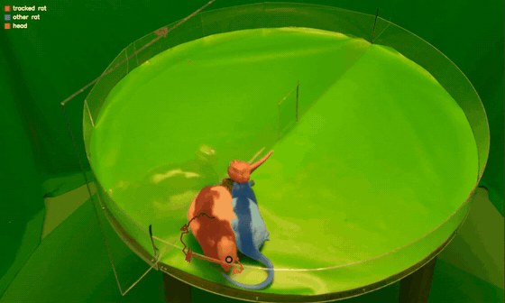</p>
<p align="center"><i>Both rats segmented in every frame with stable identities (camera 1 of 6, Day 7; red = rat 1, blue = rat 2).</i></p>

> **Model weights are not included.** Checkpoints (`*.pt`), the training
> HDF5 and all video data stay out of the repository. The code, the configs,
> the hand-made bout labels, the train/eval split and the evaluation reports
> are here.

---

## Overview

<p align="center">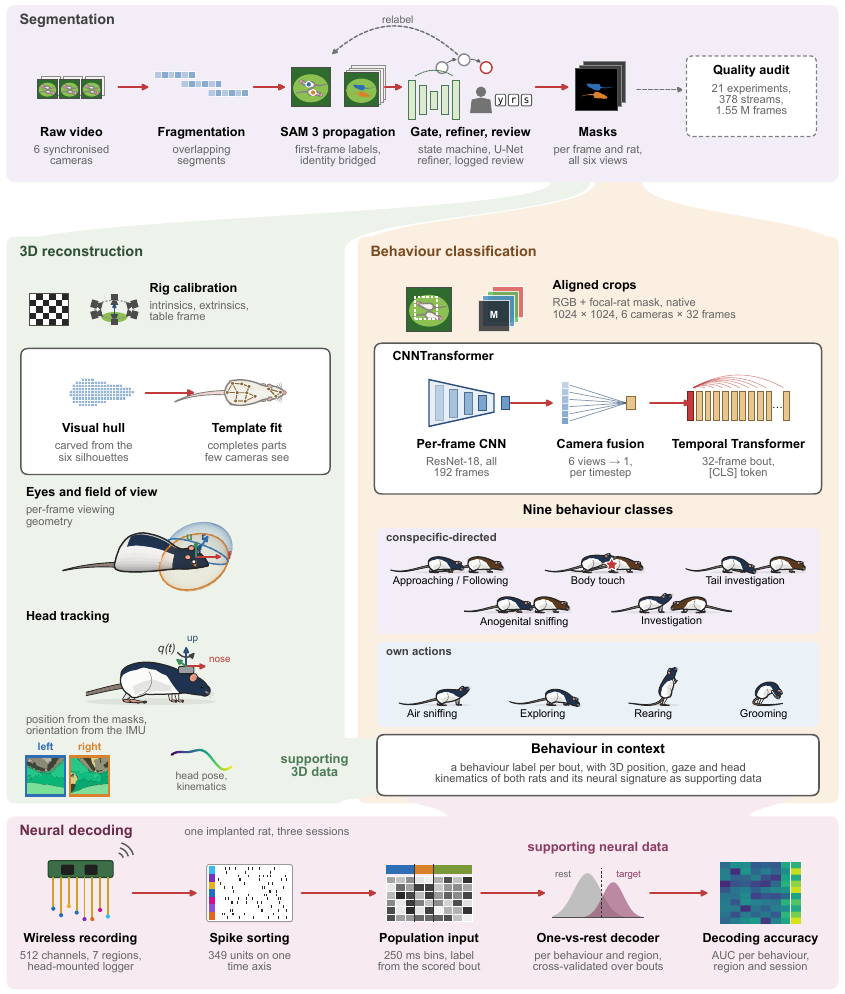</p>

| Step | Folder | What it does |
|---|---|---|
| 0 | [`scripts/0_video_trimmer`](scripts/0_video_trimmer) | browser tool to trim the six camera videos to the same frame range |
| 1 | [`scripts/1_segmentation_pipeline`](scripts/1_segmentation_pipeline) | SAM 3 video segmentation of both rats, first-frame labelling UI, fragmenting, identity bridging, absent/merge gate, U-Net mask refiner |
| 2 | [`scripts/2_preprocessing_pgn`](scripts/2_preprocessing_pgn) | per-rat cutouts from the masks, aligned 1024 × 1024 crops of both rats per camera |
| 3 | [`scripts/3_qualitiy_control`](scripts/3_qualitiy_control) | automated audit of every mask stream (empty, overfull, deviant, green contamination, cross-camera outliers) |
| 4 | [`scripts/4_building_training_data`](scripts/4_building_training_data) | RGB normalisation stats and the bout-level HDF5 (6 cameras × 32 frames per bout) |
| 5 | [`scripts/5_rat_transformer_training`](scripts/5_rat_transformer_training) | `CNNTransformer` model, training, checkpoint averaging, calibration, evaluation, held-out test |
| 6 | [`scripts/6_deployment`](scripts/6_deployment) | label new sessions, review the least confident predictions, retrain, promote or reject |

Labels and split live in [`label_clean/`](label_clean), segmentation configs per
session and camera in [`configs/`](configs), the server environment in [`env/`](env).

## 1. Segmentation (SAM 3 + mask refiner)

<p align="center">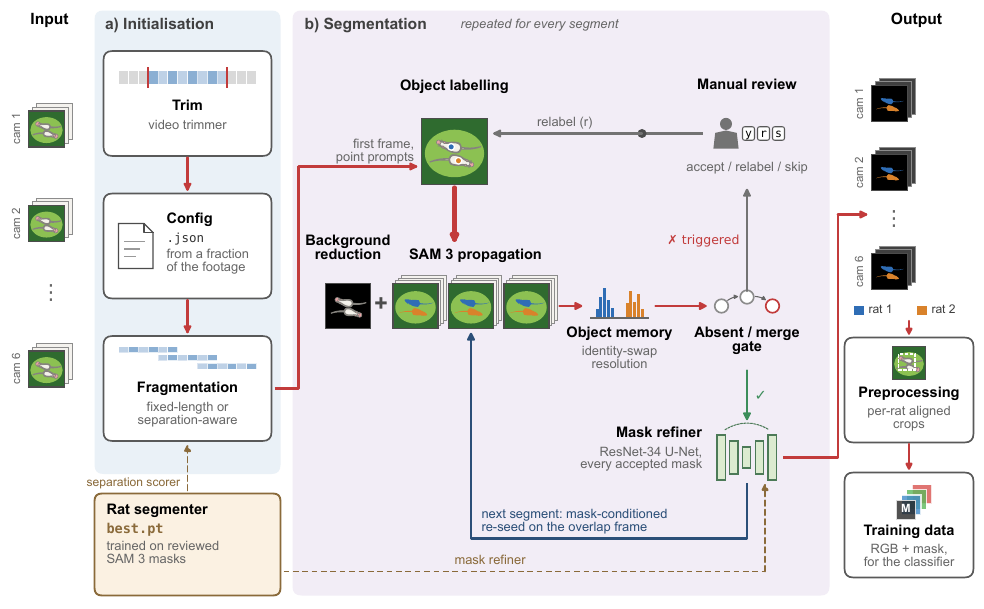</p>

Each camera video is trimmed, cut into overlapping segments, and segmented
with SAM 3 from first-frame point prompts. The prompts of the next segment are
seeded from the masks of the overlap frame, which carries each rat's identity
through the whole recording. A state machine flags frames where a rat goes
missing or the two masks merge, and only those come back to the annotator.

SAM 3 keeps identities almost perfectly but often drops the thin, shadowed
tail. A promptless **ResNet-34 U-Net** (`sam3_rat_training/`), distilled from
reviewed SAM 3 masks, predicts *where* rat pixels are; inside a trust region
around each SAM 3 mask its union replaces the SAM 3 outline, so SAM 3 decides
*which* rat and the refiner decides the exact outline
([`model_mask_refiner.py`](scripts/1_segmentation_pipeline/model_mask_refiner.py)).

<table>
  <tr>
    <td width="55%">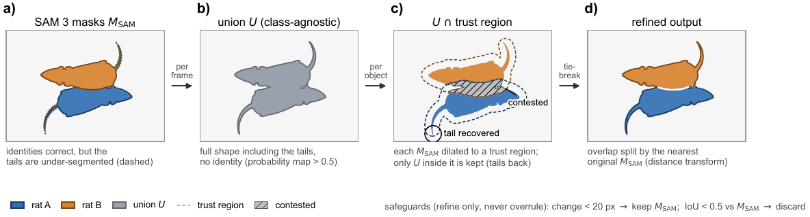</td>
    <td width="45%">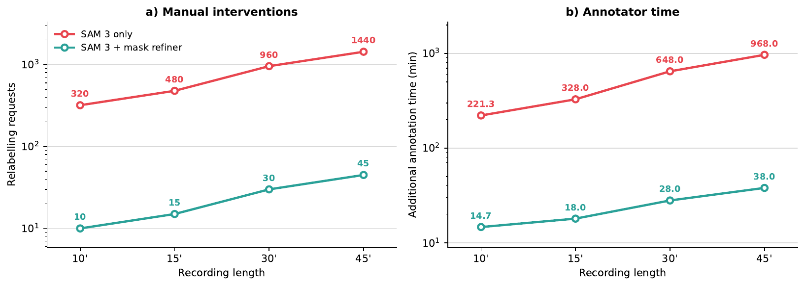</td>
  </tr>
</table>

The thesis cost model estimates that, for a 45-minute recording, the refiner
cuts the relabelling requests from about 1440 to 45 and the extra annotator
time from about 16 hours to 38 minutes.
The temporal-median background used as a foreground prior:

<p align="center">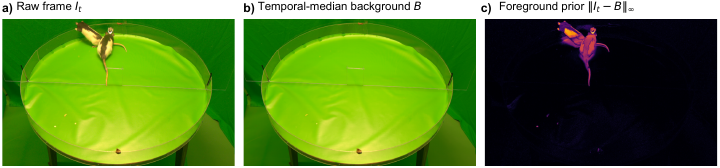</p>

## 2. Quality control

[`qc_experiment_frames.py`](scripts/3_qualitiy_control/qc_experiment_frames.py)
audits every mask stream of every experiment (21 experiments, 378 streams,
1.55 M frames in the thesis): foreground occupancy, suspicious frames per
experiment, the kind of flagged frames, and cross-camera consistency.

<p align="center">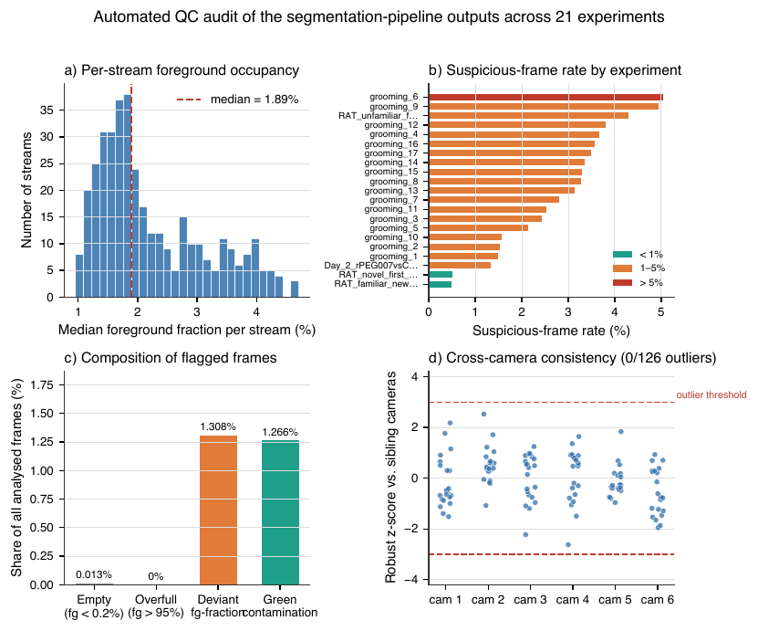</p>

## 3. Behaviour classes and data

<p align="center">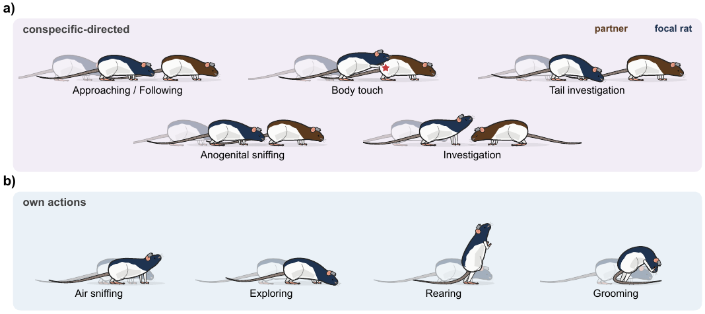</p>

Nine classes, annotated as bouts per rat: five directed at the partner
(Approaching/Following, Body touch, Tail investigation, Anogenital sniffing,
Investigation) and four own actions (Air sniffing, Exploring, Rearing,
Grooming). In the raw label files *Anogenital sniffing* is called
`Locomotion`; `Immobile` exists in the label map but is excluded from training
(`--exclude-classes Immobile`).

- [`label_clean/`](label_clean): one CSV per session and rat,
  `video,type,start_frame,end_frame,duration_frames,behavior` (30 fps, `end_frame` exclusive, frames of the
  segmented clip), plus short grooming clips.
- [`label_clean/train_eval_split.csv`](label_clean/train_eval_split.csv): every label row with its session,
  rat and split (session level, both rats of a session together; 2285 train / 713 eval bout rows).
- [`label_clean/test/`](label_clean/test): the **held-out test session** (Day 7, a different rat pair,
  137 bouts of rat 1) used only once, at the end.
- [`training_files/training_manifest.csv`](training_files/training_manifest.csv): where each session's crops
  and masks live, per camera and rat.

The HDF5 builder ([`2_build_h5_dataset.py`](scripts/4_building_training_data/2_build_h5_dataset.py)) samples
32 frames per bout and camera, at native 1024 × 1024 resolution, RGB plus the focal rat's mask.

## 4. Model: CNNTransformer

<p align="center">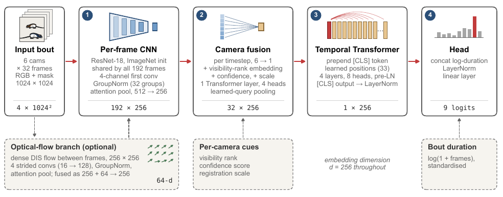</p>

- **Per-frame CNN:** ResNet-18 (ImageNet init) shared by all 6 × 32 frames, 4-channel input (RGB + focal-rat
  mask), GroupNorm, attention pooling, 256-d embedding. Optional dense DIS optical-flow branch.
- **Camera fusion:** per time step, one Transformer layer over the cameras with a visibility-rank embedding,
  mask confidence and registration scale, pooled by a learned query. Occluded cameras weigh less.
- **Temporal Transformer:** [CLS] token + 32 frame tokens, 4 layers, 8 heads.
- **Head:** [CLS] output concatenated with the standardised log bout duration (the 32-frame resampling
  removes duration), then a linear layer to 9 logits.

Training ([`train.py`](scripts/5_rat_transformer_training/train.py),
[`run_on_server.sh`](scripts/5_rat_transformer_training/run_on_server.sh)): AdamW with a lower backbone
learning rate, warm-up, backbone frozen for the first epochs, label smoothing, class weights, gradient
checkpointing. The final checkpoints are **weight averages of the five best epochs**
([`helpers/average_checkpoints.py`](scripts/5_rat_transformer_training/helpers/average_checkpoints.py));
[`helpers/calibrate.py`](scripts/5_rat_transformer_training/helpers/calibrate.py) fits a per-class logit bias
on a held-out slice of the training split and bakes it into the checkpoint. Design notes are in the
[training README](scripts/5_rat_transformer_training/README.md).

<table>
  <tr>
    <td width="58%">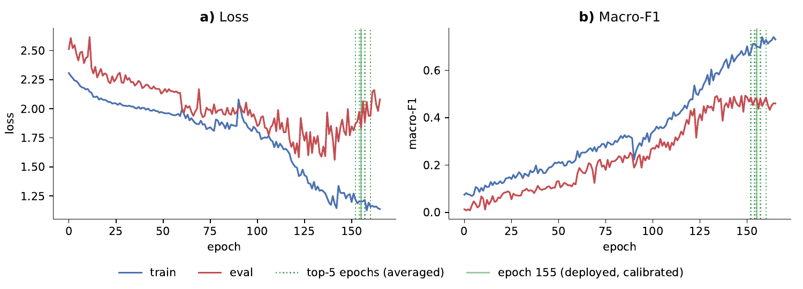</td>
    <td width="42%">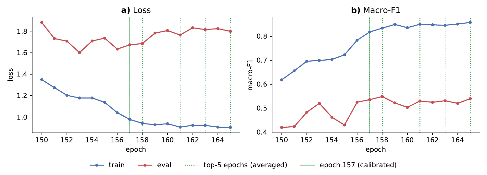</td>
  </tr>
  <tr>
    <td align="center">initial model, 166 epochs</td>
    <td align="center">retrained model, epochs 150 to 165</td>
  </tr>
</table>

| Model (average of top 5) | Eval bouts | Accuracy | Macro-F1 |
|---|---|---|---|
| Initial | 455 | 0.514 | 0.502 |
| Retrained (more Day 11 and Day 13 data, fixed label join) | 681 | 0.546 | 0.551 |

The two evaluation sets differ (the retrained one adds re-segmented Day 11 bouts), so the fair comparison is
the held-out test below. Per-class reports: `scripts/5_rat_transformer_training/training_output*/eval_*/`.

## 5. Held-out test (Day 7)

Day 7 is the only session with a different pair of rats and was never in the
HDF5. [`evaluate_raw_session.py`](scripts/5_rat_transformer_training/evaluate_raw_session.py) rebuilds the
model inputs straight from the raw SAM 3 cutouts (same crop, sampling, flow and visibility ordering as
training) and runs the model one camera and 8-frame chunk at a time, so it fits on an 8 GB laptop.
[`plot_day7_comparison.py`](scripts/5_rat_transformer_training/plot_day7_comparison.py) makes the figures,
with paired bootstrap CIs and an exact McNemar test.

<p align="center">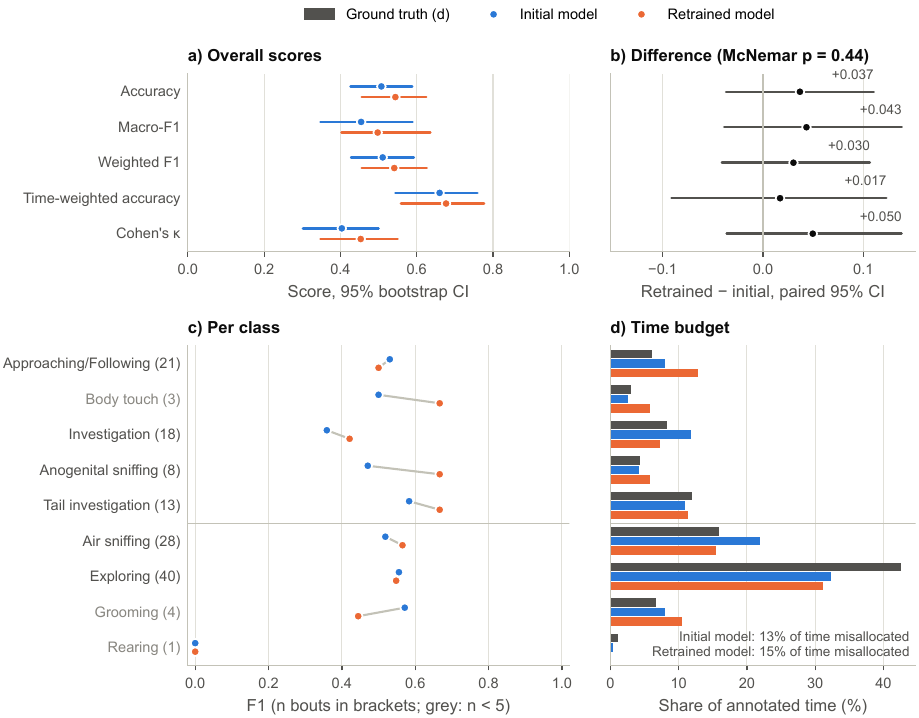</p>

| Model (average of top 5), 136 test bouts | Accuracy | Macro-F1 | Cohen's κ |
|---|---|---|---|
| Initial | 0.507 | 0.454 | 0.40 |
| Retrained | 0.544 | 0.498 | 0.45 |

The retrained model is better on the partner-sniffing classes, but with 136
bouts the gain is not significant (McNemar p = 0.44).

<table>
  <tr>
    <td width="50%">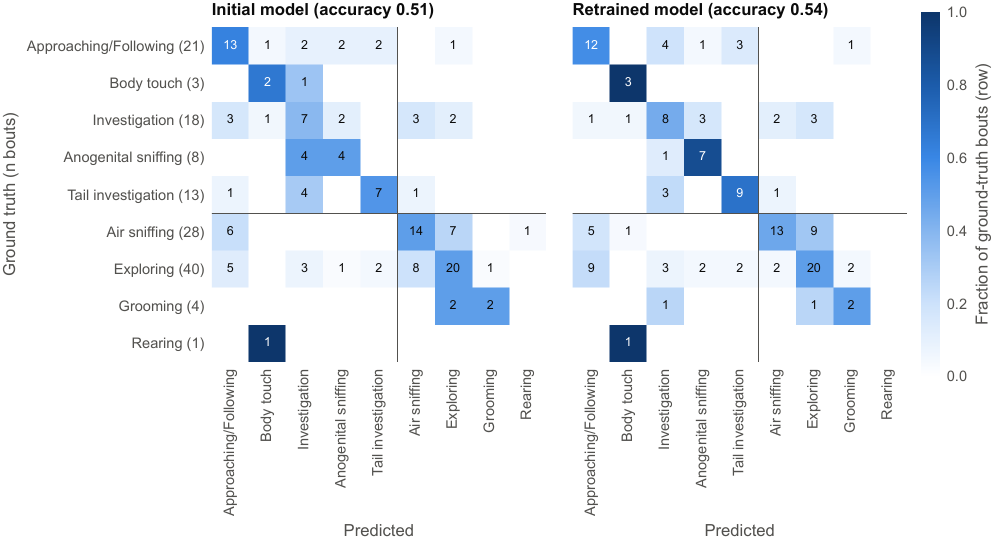</td>
    <td width="50%">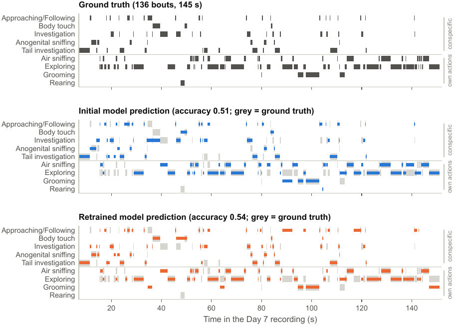</td>
  </tr>
</table>

### Where the model goes wrong

Most errors are between neighbouring classes that are hard to tell apart even
by eye. Two examples from Day 11 (labelled bout outlined):

<table>
  <tr>
    <td width="50%">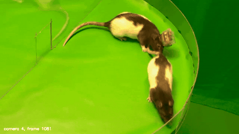</td>
    <td width="50%">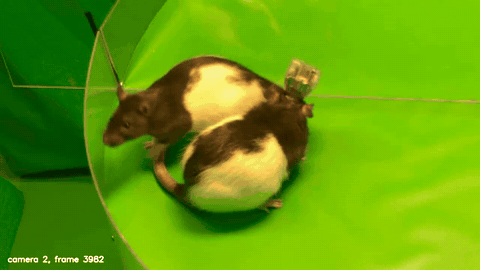</td>
  </tr>
  <tr>
    <td align="center">Tail investigation → predicted Approaching/Following</td>
    <td align="center">Body touch → predicted Investigation</td>
  </tr>
</table>

## 6. Deployment: label, review, retrain

<p align="center">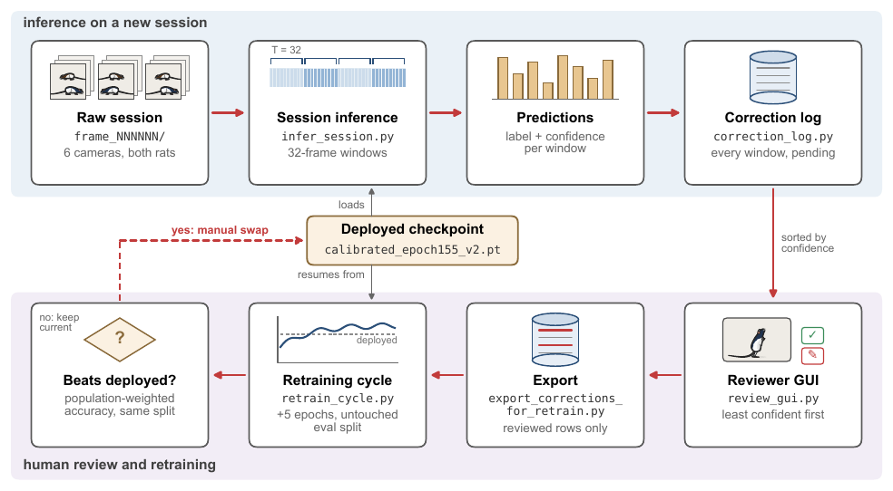</p>

[`deploy_web.py`](scripts/6_deployment/deploy_web.py) runs the model over every
32-frame window of a new session and logs each prediction. The review page
shows the least confident windows first; confirmed and corrected windows are
exported as training rows, the model trains a few more epochs, and the result
is compared with the deployed model on the untouched eval split before you
promote or reject it. See the [deployment README](scripts/6_deployment/README.md).

---

## Repository structure

```
rat-social-behaviour-classification/
├── scripts/
│   ├── 0_video_trimmer/              # trim the camera videos (browser tool)
│   ├── 1_segmentation_pipeline/      # SAM 3 pipeline, labelling UI, mask refiner
│   │   └── sam3_rat_training/        # dataset + training of the U-Net mask refiner
│   ├── 2_preprocessing_pgn/          # cutouts and aligned crops
│   ├── 3_qualitiy_control/           # mask QC audit
│   ├── 4_building_training_data/     # normstats + bout HDF5
│   ├── 5_rat_transformer_training/   # model, training, evaluation, Day 7 test
│   └── 6_deployment/                 # deploy / review / retrain web app
├── configs/            # segmentation configs per session and camera
├── label_clean/        # bout labels, train/eval split, test labels
├── training_files/     # manifest + RGB normalisation stats
├── env/                # conda environment of the GPU server (SAM 3)
├── third_party/sam3    # SAM 3 (git submodule)
├── docs/media/         # figures and GIFs of this README
├── LABELING.md         # how to run the segmentation and labelling UI
└── requirements*.txt
```

## Setup

Everything heavy (SAM 3, training, deployment) ran on a Linux GPU server; the
web tools are opened from a laptop through an SSH tunnel
(`ssh -L <port>:localhost:<port> <user>@<gpu-server>`).

```bash
git clone --recurse-submodules https://github.com/Tschedii/rat-social-behaviour-classification.git
conda env create -f env/conda_env_sam3.yml     # SAM 3 + segmentation (server)
pip install -e third_party/sam3
pip install -r scripts/5_rat_transformer_training/requirements.txt   # classifier
```

SAM 3's checkpoint comes from its own repository. Paths in `configs/` and the
`run_on_server*.sh` scripts use `/path/to/master_thesis_social_behaviour`; set
`PROJECT_ROOT` or edit them for your machine.
